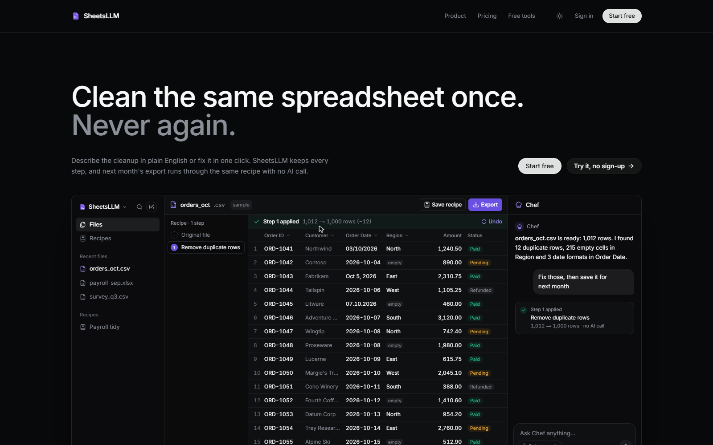
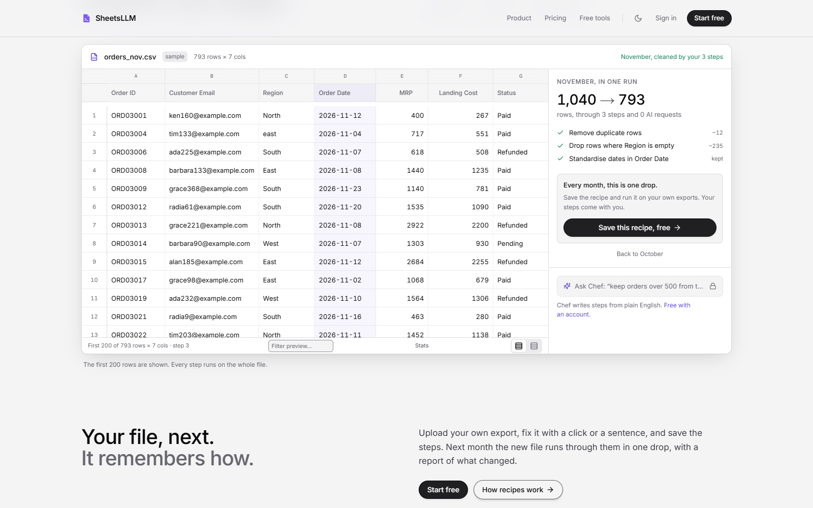
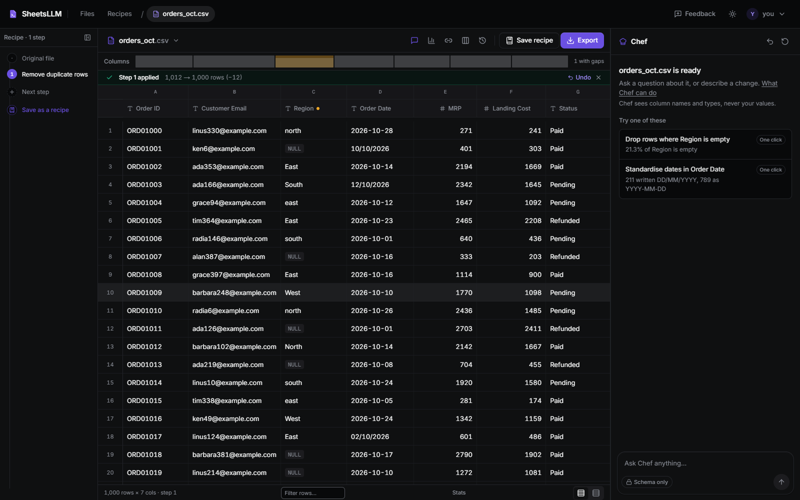
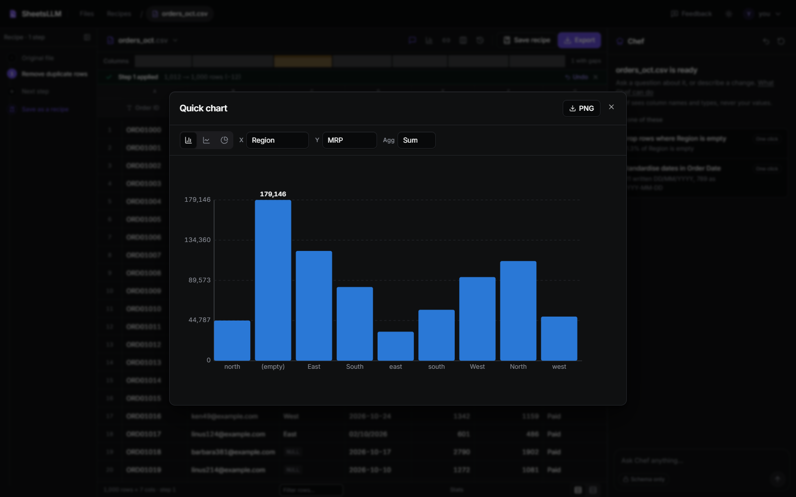

<div align="center">


# SheetsLLM

**Clean the same spreadsheet once. Never again.**

Describe a cleanup in plain English or fix it in one click. SheetsLLM keeps every step as a recipe, and next month's export runs through it with no AI call.

[**Open the app**](https://sheets-llm.vercel.app) &nbsp;·&nbsp; [Try it, no sign-up](https://sheets-llm.vercel.app/try) &nbsp;·&nbsp; [Pricing](https://sheets-llm.vercel.app/pricing) &nbsp;·&nbsp; [Free tools](https://sheets-llm.vercel.app/tools) &nbsp;·&nbsp; [What's new](https://sheets-llm.vercel.app/changelog)



</div>

---

## The problem it solves

Every month the same messy export lands on your desk, and you spend the same half hour fixing it by hand: duplicate rows, missing regions, dates written two ways, numbers stored as text. SheetsLLM lets you fix it once, with a click or a sentence, and keeps the steps. Next month's file runs through the same recipe in one drop, deterministically, with a report of what changed.

## See it before you sign up

The [try page](https://sheets-llm.vercel.app/try) opens a month of messy orders in the real engine. Click the fixes it finds, then run the same steps on November's file. No account, no AI call. Sign up and your steps come with you into the workspace.



## Features

**Cleaning**
- **One-click fixes.** Every upload is read for duplicates, empty cells, mixed date formats and numbers stored as text, and each finding comes with a fix that runs without AI. Every column menu has the rest: trim, fill empty cells, drop empty rows, remove duplicates, standardise dates, clean numbers ("$1,234.50", "(12)", "12%"), change type, keep rows where, replace a value, rename, sort, drop.
- **Chef, in plain English.** Ask for a change ("keep orders over 500 from the North") or a question about the data. Chef writes a validated, read-only query, shows the step and a few rows before anything changes, and applies it when you say so.
- **Lookup tables.** Link another file under a short name and add its columns by a key, from the column menu or by asking Chef.
- **The grid.** Sort and filter across every row, column health at a glance, stats per column, a fixed header, and wide files that show which way the rest of the columns are.
- **Charts.** Bar, line and pie with sum, average, count, min or max, exported as PNG.



**Recipes**
- **Save the steps once.** A recipe replays every step exactly, with no AI call, so the result never drifts.
- **Run reports.** Each run says how many rows each step took, and checks you set (for example "no empty Region") pass or fail on the new file.
- **Columns that moved.** When next month's export renames a column, the run matches it and remembers the match.
- **Runs on a schedule.** Give a recipe a link and a day of the month, and the cleaned file arrives by email. Reminders say when a recipe's file is due.
- **Edit and share.** Rename, reorder or remove steps, and share a recipe with a link anyone can add to their own account.

**History and trust**
- **Every step is kept** with the query it ran and the rows before and after. Undo, redo, view the file as it was at any step, or go back to it. The original is never touched.
- **Share a cleaned file** with a link that serves it for a week.
- **Every format in and out.** CSV, TSV, Excel (any sheet), JSON and Parquet, up to a million rows per file.
- **A keyboard that reaches everything.** Ctrl or Cmd K opens the command palette; "?" lists every shortcut.
- **Light and dark**, on every page.



## How it works

1. **Upload an export** or open a sample. The schema and the fixes worth making show up in seconds.
2. **Clean it** with one-click fixes or by asking Chef. Every change is a step you can see, undo or take back to.
3. **Save the steps as a recipe.** Next month, drop the new file on it: same steps, a report of what changed, no AI.

## Privacy and security

- **Strict privacy by default.** The AI is sent column names, types and counts, never a value from your file.
- **Sample rows only if you ask.** Switch strict mode off and the AI also sees a handful of sample rows, never the whole file. Every step records exactly what it sent. Recipes and one-click fixes send nothing.
- **Your data never trains any AI model.**
- **Read-only queries only.** Every query, from Chef or a template, is checked against a strict allowlist before it runs. It can read your file and nothing else.
- **Immutable originals and private accounts.** Uploads are stored once and never changed; files, history and recipes belong to your account. Download a record of the account (settings, recipes, and every file with its steps), or delete the account with everything in it.

## Pricing

Start free. Upgrade when the cleanups become a routine.

| | **Free** | **Pro** |
| --- | --- | --- |
| Price | Rs 0 / month | Rs 499 / month |
| Uploads | 50 / month | 1,000 / month |
| AI requests | 200 / month | 5,000 / month |
| Saved recipes | 3 | Unlimited |
| Rows per file | 1M | 1M |
| One-click fixes and recipe runs | Unlimited, no AI | Unlimited, no AI |
| History, undo and revert | Yes | Yes |
| Strict privacy mode | Yes | Yes |

No credit card to start, and you can cancel anytime. Your files, recipes and history are kept when you move between plans.

## Free tools

Twelve in-browser tools that need no sign-up and never upload your file:

- **Clean:** CSV cleaner, CSV duplicate remover, find and replace, change text case.
- **Reshape:** merge CSV files, CSV splitter, remove or reorder columns, split a column.
- **Convert:** Excel to CSV, JSON to CSV, CSV to JSON, CSV delimiter converter.

Try them at [sheets-llm.vercel.app/tools](https://sheets-llm.vercel.app/tools).

## Tech stack

- **Frontend:** Next.js 14 (App Router), React, TypeScript, Tailwind CSS, on Vercel.
- **Backend:** FastAPI on Python 3.12, with DuckDB running every query, on Render.
- **Platform:** Supabase for sign-in, Postgres, file storage and scheduled jobs (pg_cron). Resend for email.
- **AI:** provider-agnostic, on Google Gemini by default. One-click fixes and recipe runs never call it.

## Run it locally

You need Python 3.12, Node.js 18.17 or newer, a free Supabase project, and a Gemini key.

```bash
# Backend
cd backend
uv venv --python 3.12 .venv
uv pip install -r requirements.txt --python .venv/Scripts/python.exe   # Windows
uvicorn app.main:app --reload --port 8000

# Frontend (in a second terminal)
cd frontend
npm install
npm run dev
```

Create `backend/.env` with your Supabase project URL and keys, your Gemini key and `LLM_PROVIDER=gemini`. Create `frontend/.env` with `BACKEND_URL`, `NEXT_PUBLIC_SUPABASE_URL` and `NEXT_PUBLIC_SUPABASE_ANON_KEY`. Run the SQL migrations in `backend/migrations/` against your Supabase project, then open http://localhost:3000.

`docker compose up --build` starts both services together.

## Tests

```bash
# Backend
cd backend && .venv/Scripts/python.exe -m pytest

# Frontend: types and unit tests
cd frontend && npx tsc --noEmit && npx vitest run

# End to end, against a backend on :8000 started with LLM_PROVIDER=fake
cd frontend && E2E_BACKEND=1 npx playwright test
```

Two more suites run on demand against a local backend with `ALLOW_ANONYMOUS=true`: `E2E_SWEEP=1` clicks every control on every page and flags any that do nothing, and `README_SHOTS=1` regenerates the screenshots in this file from the running app.

## Contact

Questions or feedback: use the in-app Feedback button, email pranjalprateek9@gmail.com, or open an issue.
